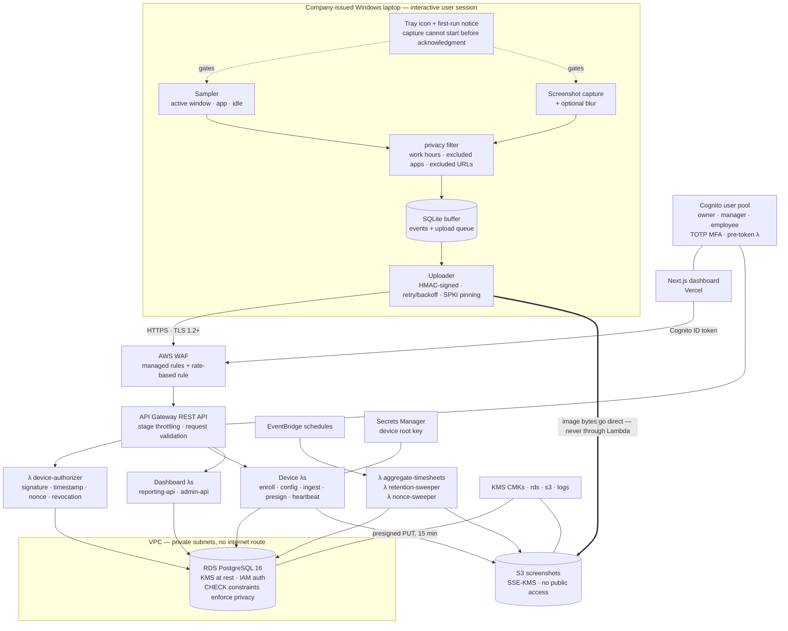

# Architecture

WorkLens has four moving parts: an agent on each monitored laptop, an AWS backend, a
Postgres database, and a web dashboard. This document explains how they fit together and,
more importantly, *why* each boundary sits where it does.

The short version: **the agent decides what is collected, the backend decides what is
stored, and the database enforces what is possible.** A privacy rule that lived only in
the dashboard would be a suggestion. Enforced at all three layers, it is a property.

---

## 1. System overview



---

## 2. Why the boundaries are where they are

### The agent filters before it persists

The privacy filter sits between capture and the SQLite buffer, not between the buffer and
the uploader. That ordering is the whole point: an excluded app, an excluded URL, or a
sample taken outside work hours is **never written to disk at all**. There is no window in
which sensitive data exists locally waiting to be filtered, so there is no bug that could
upload it, and no forensic artefact for someone to recover from the laptop later.

The tray icon is created before the first sample, and if it cannot be created the agent
exits non-zero. An agent that cannot show that it is running has no business running.

### Screenshot bytes never transit the backend

The agent asks the backend for a presigned S3 PUT and uploads the image directly. Three
consequences, all of them good: Lambda's 6 MB payload limit stops being a constraint, the
per-image compute cost disappears, and image bytes exist in exactly two places (the
laptop, briefly, and the encrypted bucket) rather than three.

The presigned URL is constrained on `Content-Length`, `Content-Type`, and the SSE-KMS
header, so it cannot be repurposed to upload something else or to write an unencrypted
object.

### Aggregation is a pure function with a thin I/O shell

`backend/src/aggregation/rollup.ts` takes events, config, and a timezone and returns a
rollup. It performs no I/O. `runner.ts` does the fetching and the upserting. The split
exists so the part with all the interesting edge cases — DST transitions, sessions
spanning midnight, all-idle days, project-rule precedence — can be tested exhaustively
without a database.

### The database is the last line, not the only line

`org_id` scoping is enforced in the repository layer, and every tenant table carries the
column. On top of that, CHECK constraints encode invariants that no application bug can
work around:

| Constraint | What it makes impossible |
|---|---|
| `activity_events_idle_no_attribution_chk` | Attributing an app, window title, or host to idle time. Idle minutes cannot leak what was on screen. |
| `monitoring_config_retention_chk` | Keeping screenshots longer than the activity that explains them. |
| `timesheets_totals_chk` | A timesheet whose parts do not sum to its total. |
| `users_employee_role_chk` | An `employee` login with no employee attached — which the RBAC middleware would otherwise have to guess about. |
| `screenshots_uploaded_chk` | A row marked uploaded with no upload timestamp. |

The `worklens_app` role can append to `audit_log` but has no `UPDATE` or `DELETE` on it,
and cannot create, alter, or drop anything. A compromised handler can read and write rows
it is scoped to. It cannot rewrite the record of who read whose data.

---

## 3. Request paths

### Enrollment

```
owner (dashboard)                backend                          agent
      │                             │                               │
      │ POST /v1/devices/           │                               │
      │      enrollment-tokens      │                               │
      ├────────────────────────────>│                               │
      │                             │ store sha256(token) only      │
      │<── wlen_… (shown once) ─────┤                               │
      │                             │                               │
      │ ─── token handed to IT / employee out of band ──────────────>│
      │                             │  POST /v1/device/enroll       │
      │                             │<──────────────────────────────┤
      │                             │ UPDATE … WHERE used_at IS NULL│
      │                             │   RETURNING  (single-use race │
      │                             │   is lost by the second call) │
      │                             │ derive secret from root key   │
      │                             ├── device_id + secret + config>│
```

The device secret is **derived, never stored**:

```
device_secret = base64url( HMAC-SHA256( root_key[key_version], org_id || ":" || device_id ) )
```

The `devices` table records only `key_version`. A database dump yields no working device
credentials. Rotation means publishing a new root key version and letting devices
re-enroll onto it; revocation is a `revoked_at` write, effective on the very next request.

### Ingestion

```
agent                                        backend
  │ collect into SQLite (client_event_id per event)
  │
  │ every 60s or at 500 events:
  │   Idempotency-Key = sha256(sorted client_event_ids)
  │   X-WL-Signature  = HMAC(secret, METHOD\nPATH\nts\nnonce\nsha256(body))
  ├───────────────────────────────────────────>│
  │                                            │ verify signature
  │                                            │ reject if |now - ts| > 300s
  │                                            │ reject if nonce already seen
  │                                            │ reject if device revoked
  │                                            │ validate with Zod (.strict())
  │                                            │ enforce per-device quota
  │                                            │ INSERT ingest_batches
  │                                            │   ON CONFLICT DO NOTHING
  │                                            │     └─ no row ⇒ this is a retry
  │                                            │ INSERT events
  │                                            │   ON CONFLICT DO NOTHING
  │<── 200 {accepted, duplicates, duplicate} ──┤
  │ delete local rows only on 2xx
```

**Idempotency is what lets the agent be simple.** It retries aggressively and without
coordination, because the server makes retries free. Both layers of deduplication —
per-batch and per-event — mean a partial failure converges rather than double-counting.

### Dashboard read of a screenshot

```
browser ──ID token──> reporting-api
                          │ verify Cognito token, read org/role/employee from claims
                          │ if role = employee and target ≠ self → 403
                          │ if role ∈ {owner, manager} and wl:mfa ≠ on → 403
                          │ INSERT audit_log (screenshot.view, subject_employee_id)
                          │ presign GET, 300s
browser <── short-lived URL ┘
```

The audit row is written **before** the URL is issued. If the write fails, no URL is
issued — the trail cannot fall behind the access.

---

## 4. Data flow through the day

```
09:03  agent samples: chrome.exe · "Timesheet — WorkLens" · not idle
       privacy filter: within work hours, app not excluded → buffered
09:04  identical sample → coalesced, duration_seconds += 60
11:47  no input for 5 minutes → idle_state event, is_idle = true
       app and title are DROPPED (the CHECK constraint would reject them anyway)
12:15  laptop sleeps → session_end
13:02  wakes, offline on a train → events accumulate in SQLite
14:30  network returns → uploader drains the buffer in 500-event batches
02:15  EventBridge → aggregate-timesheets, in each employee's own timezone
       → timesheets + app/site/category/project child rows for that work_date
03:30  retention-sweeper deletes events past retention_days_events and
       screenshots past retention_days_screenshots, DB rows and S3 objects
```

`AGGREGATION_LOOKBACK_DAYS` defaults to 3 rather than 1 precisely because of the train:
an agent offline overnight uploads yesterday's events today, and that late data has to
land in the right day's timesheet.

---

## 5. Component responsibilities

| Component | Owns | Explicitly does not |
|---|---|---|
| **Agent** (`agent/`) | Sampling, idle detection, screenshots, blur, local privacy filtering, buffering, signed upload, tray visibility, first-run notice | Decide policy (it fetches config), retain data after upload, capture any content |
| **Device λs** | Credential verification, validation, idempotency, quota, presign issuance | Trust anything in the payload about identity — org, employee, and device come from the verified credential |
| **Dashboard λs** | RBAC, audit writes, aggregate reads, exports | Scan raw `activity_events` for dashboard views (one bounded "recent activity" query aside) |
| **Jobs** | Aggregation, retention, nonce expiry | Anything a user waits on |
| **Database** | Invariants, `org_id` scoping, append-only audit | Store secrets, or any column for content capture |
| **Dashboard** (`dashboard/`) | Presentation, employee self-view, export rendering | Authorisation decisions — the server decides and the UI reflects |

---

## 6. Failure behaviour

Designed for, and tested against, the unhappy path:

| Failure | Behaviour |
|---|---|
| Backend unreachable | Agent buffers to SQLite, retries with exponential backoff and jitter. Nothing is lost until the buffer cap (250 MB / 14 days) is reached, at which point the **oldest** events are dropped and an `agent_health` event records the loss — so a gap in a timesheet is always explainable. |
| Duplicate batch after a timeout | `ingest_batches` unique constraint returns no row; handler answers `200 {duplicate: true}`; agent drops its copy. No double counting. |
| Partially applied batch | Per-event `ON CONFLICT DO NOTHING` means the retry inserts only what is missing. |
| S3 upload fails mid-batch | Screenshot row stays `pending`; the retention sweeper expires rows still pending after 24 h. |
| Clock skew on the laptop | Requests outside the ±300 s window are rejected with a distinguishable error, so `agentctl doctor` can report "your clock is wrong" instead of "auth failed". |
| Device revoked | Next request fails closed. The agent stops capturing and the tray reports it. |
| Employee outside work hours | Nothing is captured, so nothing exists to filter later. |
| Aggregation run twice | Idempotent upsert on `(org_id, employee_id, work_date)`, `version` increments. |
| Cognito user without MFA on an admin route | 403 from the server, plus a forced-enrolment redirect in the UI. |

---

## 7. What is deliberately not built

- **Browser-extension URL capture.** It would yield true URLs with paths and query
  strings. Window-title capture yields a page title and sometimes a host. The narrower
  source is the correct one for this product, and the limits are documented in
  `docs/AGENT.md` rather than hidden.
- **Real-time streaming.** Batched upload at a 60-second sample interval is sufficient for
  timesheets and costs a fraction of a streaming pipeline.
- **Multi-region.** Single region, matching a single-company deployment and the
  data-localisation argument for keeping Indian employee data in India.
- **RDS Proxy.** Not needed below roughly 200 devices; documented in
  `docs/OPERATIONS.md` as the scale-up path so the decision is recorded rather than
  rediscovered.
- **A NAT gateway.** Avoided by RDS IAM authentication, an S3 gateway endpoint, and a
  single Secrets Manager interface endpoint — about $33/month saved with no capability
  lost.

Every one of these is a decision with a reason, not an omission. See `docs/PLAN.md` §1 for
the ten deviations from the original specification and the justification for each,
including the two cases where the specification asked for something that does not work:
a Windows service cannot see the interactive desktop, and AWS WAF cannot attach to an API
Gateway HTTP API.
