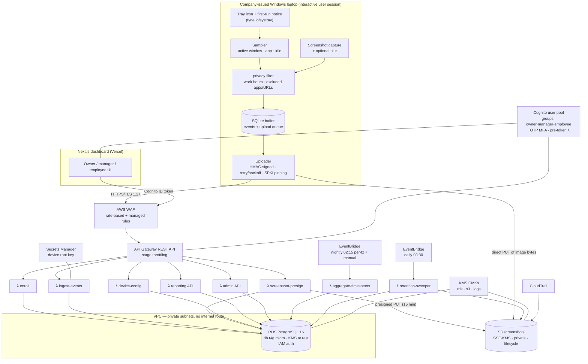

# WorkLens — Phase 0 Plan

**Status:** Phase 0 (plan only — no implementation code exists yet)
**Document owner:** build agent
**Source of requirements:** `docs/MASTER_BUILD_PROMPT.md`

---

## 0. What is being built

WorkLens is a **transparent** employee time-tracking and activity-monitoring system for a
single-company deployment. A Go agent runs on company-issued Windows laptops, samples work
activity, buffers it locally, and ships it to an AWS backend. A nightly (and on-demand) job rolls
raw events into per-employee daily timesheets. A Next.js dashboard lets an owner review
timesheets and export them for payroll — and lets every employee see their own data.

The product's differentiator is not the feature list, it is the **posture**: least-invasive
defaults, no content capture of any kind, a visible agent, and documentation that tells the
deployer to get consent and legal sign-off before rolling it out.

### The hard constraints, restated as build rules

These are non-negotiable and are enforced structurally, not by convention:

| Constraint | How the design enforces it |
|---|---|
| No keystroke content capture | The agent never calls `SetWindowsHookEx`, `GetAsyncKeyState`, or any raw-input API. Idle detection uses `GetLastInputInfo`, which returns only a *timestamp* of the last input — the OS gives us no key data even if we wanted it. There is no `key`, `keystroke`, or `input_content` column anywhere in the schema. |
| No password capture | Follows from the above — no keyboard hook exists. |
| No webcam | No camera dependency is linked; no capture device is opened. |
| No microphone | No audio dependency is linked. |
| No clipboard capture | `OpenClipboard`/`GetClipboardData` are never called. |
| Agent is visible & transparent | Tray icon is created before the first sample is taken; if tray creation fails, the agent **exits** rather than run invisibly. First-run notice must be acknowledged before capture starts, and the acknowledgment is persisted and uploaded. |
| Least-invasive defaults | Defaults ship as: screenshots **off**, URL capture **off**, window titles **on**, work-hours-only **on**, 60 s sampling. A deployer must consciously opt in to anything more. |
| Privacy rules honoured locally | Exclusion / work-hours / blur checks all run in `internal/privacy` **before** an event or image is written to the local buffer, so excluded data is never persisted and therefore can never be uploaded. |
| Secure by default | Section 6 below. |
| Responsible-use docs mandatory | `docs/RESPONSIBLE_USE.md` + a prominent README section; CI fails if the README section heading is missing (a real check, not a promise). |

---

## 1. Chosen stack, and every deviation with its reason

### Taken as specified

- **Agent:** Go 1.23, single static binary, Windows first (`GOOS=windows GOARCH=amd64`), structured
  so a macOS backend can be dropped in behind the same interfaces.
- **Windows APIs** via `golang.org/x/sys/windows`: `GetForegroundWindow`, `GetWindowTextW`,
  `GetWindowThreadProcessId`, `QueryFullProcessImageNameW`, `GetLastInputInfo`.
- **Screenshots** via `github.com/kbinani/screenshot`.
- **Local buffer:** SQLite. Driver: `modernc.org/sqlite` (pure Go, **no cgo**) — this is what keeps
  `CGO_ENABLED=0` cross-compilation working, which the spec's "single static binary,
  cross-compiles" requirement depends on. `mattn/go-sqlite3` would break it.
- **Backend:** AWS — API Gateway → Lambda, PostgreSQL on RDS, S3 for screenshots with SSE-KMS and
  presigned uploads, EventBridge scheduled rule → aggregation Lambda, Cognito for dashboard auth.
- **Frontend:** Next.js 15 (App Router) + TypeScript + Tailwind CSS v4 + Recharts. Deploy: Vercel.
- **IaC:** Terraform. The whole backend comes up with one `terraform apply`.
- **Reproducibility:** `Makefile` at the root plus `scripts/` for build, test, deploy.

### Deviations, each with justification

**D1 — Lambda language: TypeScript on Node 22 (ARM64), not Go.**
The spec says "Go or TypeScript/Node — pick one, justify". TypeScript wins here because the
dashboard is already TypeScript, so the **request/response contract is shared as real code**:
one set of Zod schemas in `backend/src/shared/schemas/` is used for Lambda input validation *and*
imported by the dashboard for typed fetches. Picking Go for Lambda would mean maintaining the
same contract twice, in two languages, with drift as the default outcome. Go stays where it is
load-bearing — the agent, where a static binary and Win32 syscalls are the requirement.
Cold start on Node 22 / ARM64 with esbuild-bundled handlers is ~250–400 ms, which is
irrelevant for a batch-ingest workload sampling at 60 s intervals.

**D2 — API Gateway REST API, not HTTP API.**
The spec suggests HTTP API, but Section 9 requires **WAF on the API**, and AWS WAF cannot be
attached to an API Gateway HTTP API — only to REST APIs, ALBs, AppSync, and CloudFront. The two
ways to satisfy Section 9 are (a) REST API with a WAF WebACL attached directly, or (b) HTTP API
behind CloudFront with WAF on the distribution. **(a) is chosen**: fewer moving parts, no extra
cache layer in front of an API that must not be cached, and REST API additionally gives
request-model validation and usage-plan throttling for free. Cost delta is $3.50 vs $1.00 per
million requests — at ~1.4 M requests/month for 50 devices that is roughly $3.50 vs $1.40. If a
future deployer drops the WAF requirement, `infra/modules/api/` can be swapped for HTTP API
without touching handler code, because everything uses Lambda proxy integration.

**D3 — Device authentication: HMAC-SHA256 request signing, not a bearer JWT.**
The spec allows "signed JWT or mutual TLS". A bearer JWT is a *replayable* credential: anyone who
captures one request can replay it until expiry, and shortening expiry forces a refresh-token
dance into an agent that is frequently offline. Instead each request carries:

```
X-WL-Device:    <device_id>
X-WL-Timestamp: <unix seconds>
X-WL-Nonce:     <128-bit random, hex>
X-WL-Signature: <hex HMAC-SHA256(device_secret, canonical_request)>

canonical_request = METHOD "\n" PATH "\n" timestamp "\n" nonce "\n" hex(sha256(body))
```

This authenticates the device **and** the body, and rejects replays via a ±300 s timestamp window
plus a nonce-seen table. Revocation is a `devices.revoked_at` write, effective on the next
request — strictly faster than waiting out a JWT's TTL. Mutual TLS was rejected because it
requires a private CA, per-device certificate issuance and rotation, and an API Gateway custom
domain with a truststore in S3 — a large amount of operational surface for a 1-org deployment.

**D4 — Device secrets are derived, not stored.**
HMAC verification needs the device's secret in plaintext at verify time, so hashing it in the
database (the right answer for passwords) is not available. Rather than store recoverable secrets
per device, the secret is **derived on demand**:

```
device_secret = base64url( HMAC-SHA256( root_key[key_version], org_id || ":" || device_id ) )
```

The root key lives in Secrets Manager and is fetched once per Lambda container. The `devices`
table stores `key_version` only — **there is no secret material in the database at all**, so a
database dump does not yield working device credentials. Rotation = publish `root_key_v2`, bump
`devices.key_version` as agents re-enroll, retire v1.

**D5 — The agent runs as a per-user logon task, not a Windows service. This corrects the spec.**
Section 6 asks for "run as a background service". On Windows that is not implementable for this
feature set: services run in **session 0**, which is isolated from interactive desktops since
Windows Vista. From session 0, `GetForegroundWindow` returns the session-0 desktop's foreground
window (nothing useful), `GetLastInputInfo` reports session-0 input (never any), and screen
capture returns a black or blank frame. A service-based agent would silently report every employee
as permanently idle.

The design instead installs a **Scheduled Task with an "at logon" trigger** running as the
logged-on interactive user at normal integrity, with `RestartCount=3` / `RestartInterval=1m` for
crash recovery, plus an in-process supervisor around each capture goroutine. This is also the
*more transparent* option, which the product posture wants: a process in the user's own session
with a visible tray icon, killable by the user, rather than a SYSTEM service they cannot see or
stop. `agentctl install` / `uninstall` manage the task. Documented in
`docs/AGENT.md#why-not-a-service`.

**D6 — Lambda↔RDS connectivity without a NAT Gateway.**
Section 9 requires the database in a private subnet, which puts the data-plane Lambdas in the VPC.
A naive setup then needs a NAT Gateway (~$33/mo + data processing) just so Lambda can reach
Secrets Manager. Avoided by: **RDS IAM authentication** for database connections (the auth token
is computed locally by the SDK — zero network calls), a **free S3 gateway endpoint** for
screenshot operations, and a single **Secrets Manager interface endpoint** (~$7.30/mo) for the
device root key. No NAT Gateway. Connection pressure is handled with a module-scope pool of
`max: 1` per container plus reserved concurrency on the ingest function; RDS Proxy is documented
in `docs/OPERATIONS.md` as the scale-up path past ~200 devices, not paid for at 1-org scale.

**D7 — Admin MFA is enforced server-side, not just by pool policy.**
Cognito MFA settings are pool-wide (`OFF`/`OPTIONAL`/`REQUIRED`), so "MFA required for admin
accounts" cannot be expressed as pool config without also forcing TOTP on every employee
self-view login. Implementation: pool MFA = `OPTIONAL` (software token), and a
**pre-token-generation Lambda** calls `AdminGetUser`, inspects `UserMFASettingList`, and injects a
`wl:mfa` claim. The API middleware **rejects any request to an admin-scoped route when the caller
is in the `owner` or `manager` group and `wl:mfa !== "on"`**, and the dashboard routes such users
to a forced-enrollment screen. Enforcement lives on the server, where it counts.

**D8 — Certificate pinning targets the CA SPKI, not the leaf.**
Section 9 requires pinning in the agent. Pinning the leaf certificate would break the entire
fleet every time ACM rotates the certificate (~13 months, and ACM can rotate early). The agent
pins a **configurable set of SPKI SHA-256 hashes** verified in a custom
`tls.Config.VerifyPeerCertificate`, defaulting to *Amazon Root CA 1* and *Amazon Root CA 2*
(two pins so either can be retired without an outage). `docs/SECURITY.md` documents the rollover
procedure and how to add a pin ahead of a CA change. Pinning can be disabled only via an
explicitly named `WORKLENS_TLS_PINNING=off` flag, which logs a warning on every startup.

**D9 — URL capture is title-derived and off by default.**
The spec asks for "website/URL capture from the active browser (via active-tab title / window
title; document the approach and its limits)". Implemented exactly as scoped, and the limits are
documented plainly in `docs/AGENT.md#url-capture-limits`: browser window titles give
`"<page title> — <Browser>"`, which yields a page title and *sometimes* a host, never a full URL
with path or query. Titles of pages on excluded hosts still cannot leak, because exclusion
patterns are matched against both the derived host and the raw title before the event is stored.
A browser-extension source would give true URLs; it is listed as future work and deliberately not
built, because it widens the data collected.

**D10 — Screenshot blur is implemented in-repo, not pulled from an image library.**
A three-pass box blur over an `image.RGBA` is ~70 lines and removes a dependency
(`disintegration/imaging` is unmaintained; `bild` pulls a wider tree). It is also unit-testable
against a known fixture, which matters because blur is a *privacy control* — if it silently
no-ops, sensitive pixels ship. `internal/screenshot/blur_test.go` asserts the variance of a
high-contrast fixture drops below a threshold after blurring.

---

## 2. Architecture and data flow



### Enrollment

1. An owner/manager creates an enrollment token in the dashboard:
   `POST /v1/devices/enrollment-tokens` with `{ employee_id, expires_in_hours }`.
   The API returns a one-time token of the form `wlen_<base64url(32 random bytes)>`; only
   `sha256(token)` is stored in `enrollment_tokens.token_hash`.
2. The employee (or an IT operator) runs `worklens-agentctl enroll --token wlen_...`.
3. `POST /v1/device/enroll` validates the token — unexpired, unused, org-scoped — inside a
   single transaction that marks it used (`UPDATE ... WHERE used_at IS NULL RETURNING`, so a
   concurrent double-enroll loses the race rather than producing two devices).
4. The Lambda inserts the `devices` row, derives `device_secret` per **D4**, and returns
   `{ device_id, device_secret, org_id, employee_id, config, config_version }`.
5. The agent writes `device_id`/`device_secret` to `%LOCALAPPDATA%\WorkLens\credentials.json`
   with an ACL restricted to the user and Administrators, and **never logs the secret**.

### Ingestion

1. The sampler emits events into SQLite; each gets a client-side UUIDv4 `client_event_id`.
2. Every 60 s (configurable), or immediately when the buffer exceeds 500 events, the uploader
   takes up to 500 events, computes a batch `Idempotency-Key` = `sha256` of the sorted
   `client_event_id` list, signs the request per **D3**, and POSTs to `/v1/device/events`.
3. The Lambda: verifies signature → checks timestamp window and nonce → checks the device is not
   revoked → validates the payload with Zod → enforces the per-device quota → inserts
   `ingest_batches` with `ON CONFLICT (device_id, idempotency_key) DO NOTHING`. If the insert
   returns no row, the batch is a retry: respond `200 {"accepted":0,"duplicate":true}` so the
   agent can drop it.
4. Events insert with `ON CONFLICT (device_id, client_event_id) DO NOTHING`, so partial-failure
   retries converge. The response reports `accepted` and `duplicates`; the agent deletes local
   rows only on a 2xx.
5. **Idempotency is the whole design here** — the agent is allowed to be dumb and retry
   aggressively, because the server makes retries free.

### Screenshots

1. Agent captures → applies blur if configured → **checks exclusions and work hours** → writes the
   PNG to `%LOCALAPPDATA%\WorkLens\queue\<uuid>.png` and enqueues a row.
2. `POST /v1/device/screenshots` with `{ captured_at, width, height, bytes, sha256, blurred }`
   returns `{ screenshot_id, upload_url, s3_key }`. `upload_url` is a 15-minute presigned PUT
   pinned to `Content-Length`, `Content-Type: image/png`, and the SSE-KMS header, so the URL
   cannot be used to upload something else.
3. Agent PUTs bytes straight to S3 — image data never transits Lambda, so there is no 6 MB
   payload ceiling and no per-image compute cost.
4. `POST /v1/device/screenshots/{id}/complete` flips `upload_state` to `uploaded`. Rows left
   `pending` for over 24 h are swept by the retention Lambda.
5. The bucket blocks all public access; the dashboard reads images through short-lived presigned
   GETs issued by the reporting API **only after** an RBAC check, and every issue writes an
   `audit_log` row.

### Aggregation

An EventBridge rule fires `aggregate-timesheets` nightly, and `POST /v1/aggregation/run` triggers
it on demand. For each `(employee, work_date)` in scope, in the **employee's** timezone:

- `active_seconds`, `idle_seconds`, `total_seconds`
- `first_activity_at`, `last_activity_at`
- per-app, per-category, per-site, and per-project second totals (child tables)
- `screenshot_count`, `source_event_count`, `computed_at`, and a bumped `version`

Aggregation is a **pure function** — `aggregate(events, config, timezone) -> TimesheetRollup` in
`backend/src/aggregation/rollup.ts`, with no I/O — precisely so it can be unit-tested hard
(Section 10 requires tests on the aggregation logic). Writes are idempotent upserts on
`(org_id, employee_id, work_date)`, so re-running a night is always safe.

### Serving

Reporting Lambdas read the aggregate tables (never scan `activity_events` for dashboard views,
except the single "recent activity" query which is bounded by `LIMIT` and an index on
`(org_id, captured_at DESC)`). Every read path takes `org_id` from the verified token, never
from user input.

---

## 3. Data model

PostgreSQL 16. Every tenant-scoped table carries `org_id uuid not null` even though this is a
single-tenant deployment, and every query filters on it — isolation from day one, as the spec
requires. Timestamps are `timestamptz` stored UTC; `work_date` is a plain `date` interpreted in
the employee's IANA timezone. Migrations are forward-only, numbered SQL files, tracked in
`schema_migrations`.

```
organizations
  id uuid pk · name · slug uq · timezone text (IANA) · created_at · updated_at

users                                  -- dashboard users
  id uuid pk · org_id fk · cognito_sub text uq · email citext uq
  role text check (owner|manager|employee) · employee_id fk null   -- set for self-view
  status text (active|disabled) · last_login_at · created_at · updated_at

employees
  id uuid pk · org_id fk · full_name · email citext · external_ref text null
  timezone text (IANA, defaults to org) · status (active|inactive)
  hired_on date null · created_at · updated_at
  uq (org_id, email)

devices
  id uuid pk · org_id fk · employee_id fk · hostname · os · os_version
  agent_version · machine_fingerprint text · key_version int not null default 1
  enrolled_at · last_seen_at · last_config_fetch_at · revoked_at null
  notice_acknowledged_at null                       -- first-run notice, uploaded from agent
  quota_window_started_at · quota_event_count int   -- per-device leaky bucket (D6)
  created_at · updated_at
  idx (org_id, employee_id) · idx (org_id, last_seen_at desc)

enrollment_tokens
  id uuid pk · org_id fk · employee_id fk · token_hash bytea uq
  expires_at · used_at null · used_by_device_id fk null
  created_by_user_id fk · created_at

ingest_batches
  id uuid pk · org_id fk · device_id fk · idempotency_key text
  event_count int · byte_count int · received_at
  uq (device_id, idempotency_key)

device_nonces                                       -- replay protection (D3)
  device_id fk · nonce text · seen_at
  pk (device_id, nonce) · idx (seen_at)              -- swept hourly, 600 s retention

activity_events
  id bigint identity pk · org_id fk · employee_id fk · device_id fk
  client_event_id uuid · event_type text check (window_sample|idle_state|session_start|
                                                session_end|notice_ack|agent_health)
  captured_at timestamptz · duration_seconds int check (>= 0 and <= 3600)
  app_name text null · app_exe text null · window_title text null
  url_host text null · url_title text null
  category text null · project_id fk null · is_idle boolean not null
  created_at
  uq (device_id, client_event_id)                   -- idempotency
  idx (org_id, employee_id, captured_at)
  idx (org_id, captured_at desc)
  -- NOTE: no column exists, or may ever be added, for keystroke or clipboard content.

screenshots
  id uuid pk · org_id fk · employee_id fk · device_id fk
  captured_at · s3_bucket · s3_key uq · content_type · width int · height int
  byte_count int · sha256 bytea · blurred boolean not null
  upload_state text check (pending|uploaded|expired) · uploaded_at null · created_at
  idx (org_id, employee_id, captured_at desc)

projects
  id uuid pk · org_id fk · name · code text null · is_active boolean · created_at · updated_at
  uq (org_id, name)

project_rules                          -- how raw activity maps to a project
  id uuid pk · org_id fk · project_id fk
  match_type text check (app_exe|url_host|title_contains|title_regex)
  pattern text · priority int · created_at
  idx (org_id, priority)

app_categories                         -- app/host -> category, for category rollups
  id uuid pk · org_id fk · match_type text check (app_exe|url_host)
  pattern text · category text · priority int
  uq (org_id, match_type, pattern)

monitoring_config                      -- one row per org; the agent's source of truth
  org_id uuid pk fk · config_version int not null
  sample_interval_seconds int default 60 · idle_threshold_seconds int default 300
  capture_window_titles boolean default true
  capture_urls boolean default false                -- least-invasive default
  screenshot_enabled boolean default false          -- least-invasive default
  screenshot_interval_seconds int default 900 · screenshot_blur boolean default true
  work_hours_only boolean default true              -- least-invasive default
  work_hours_start time default '09:00' · work_hours_end time default '17:30'
  work_days smallint[] default '{1,2,3,4,5}'        -- ISO-8601: 1=Monday .. 7=Sunday
  excluded_apps text[] · excluded_url_patterns text[]
  retention_days_events int default 90 · retention_days_screenshots int default 30
  updated_by_user_id fk null · updated_at

timesheets
  id uuid pk · org_id fk · employee_id fk · work_date date · timezone text
  active_seconds int · idle_seconds int · total_seconds int
  first_activity_at null · last_activity_at null
  screenshot_count int · source_event_count int
  version int · computed_at · created_at
  uq (org_id, employee_id, work_date)
  idx (org_id, work_date desc)

timesheet_app_totals       timesheet_id fk · app_name · seconds int   pk (timesheet_id, app_name)
timesheet_site_totals      timesheet_id fk · url_host · seconds int   pk (timesheet_id, url_host)
timesheet_category_totals  timesheet_id fk · category · seconds int   pk (timesheet_id, category)
timesheet_project_totals   timesheet_id fk · project_id fk · seconds int
                                                                     pk (timesheet_id, project_id)
  -- all four: on delete cascade from timesheets

audit_log                              -- who viewed whose data
  id bigint identity pk · org_id fk
  actor_user_id fk null · actor_email text · actor_role text
  action text            -- e.g. screenshot.view, timesheet.export, config.update, device.revoke
  subject_type text · subject_id text null · subject_employee_id fk null
  ip inet null · user_agent text null · metadata jsonb · created_at
  idx (org_id, created_at desc) · idx (org_id, subject_employee_id, created_at desc)

data_deletion_requests                 -- employee-data-deletion (right to erasure)
  id uuid pk · org_id fk · employee_id fk · scope text check (all|screenshots|events)
  requested_by_user_id fk · reason text · requested_at
  status text check (pending|completed|failed) · completed_at null
  deleted_event_count int null · deleted_screenshot_count int null · error text null

schema_migrations
  version text pk · checksum text · applied_at
```

**Deletion semantics.** `data_deletion_requests` drives a *hard* delete: `activity_events` and
`screenshots` rows are `DELETE`d and the S3 objects removed with `DeleteObjects`, in batches, with
the counts recorded on the request row. The `audit_log` entry describing the deletion is retained
deliberately — a deletion you cannot prove happened is worse than useless. This is stated in
`docs/RESPONSIBLE_USE.md`.

---

## 4. API surface

Base: `https://<api-id>.execute-api.<region>.amazonaws.com/v1` (or a custom domain).
All responses are JSON; errors use `{ "error": { "code", "message", "details"? } }` with codes
from a single enum in `backend/src/shared/errors.ts`.

### Device API — HMAC auth (D3), Lambda authorizer `device-authorizer`

| Method | Path | Purpose |
|---|---|---|
| `POST` | `/v1/device/enroll` | One-time enrollment with `wlen_` token. Unauthenticated by HMAC (no secret yet); rate-limited hard by WAF + token single-use. |
| `GET` | `/v1/device/config` | Returns `monitoring_config` + `config_version`. Agent polls every 15 min. |
| `POST` | `/v1/device/events` | Batched ingest. `Idempotency-Key` required. Max 500 events / 1 MB. |
| `POST` | `/v1/device/screenshots` | Request presigned PUT. Rejected if `screenshot_enabled = false`. |
| `POST` | `/v1/device/screenshots/{id}/complete` | Confirm upload. |
| `POST` | `/v1/device/heartbeat` | Updates `last_seen_at`, reports agent version + health. |
| `POST` | `/v1/device/notice-ack` | Records first-run notice acknowledgment. |

### Dashboard API — Cognito ID-token authorizer + RBAC middleware

RBAC: `owner` = everything. `manager` = read all employees, no settings/user management.
`employee` = **only** their own `employee_id`, enforced in the middleware by rewriting the query
scope, not by trusting a path parameter.

| Method | Path | Roles |
|---|---|---|
| `GET` | `/v1/me` | all |
| `GET` | `/v1/overview?date=` | owner, manager |
| `GET` | `/v1/employees` · `POST` · `PATCH /{id}` | owner (write), manager (read) |
| `GET` | `/v1/employees/{id}/timesheets?from=&to=` | owner, manager, self |
| `GET` | `/v1/employees/{id}/activity?date=&cursor=` | owner, manager, self |
| `GET` | `/v1/employees/{id}/screenshots?date=` | owner, manager, self — audited |
| `GET` | `/v1/employees/{id}/screenshots/{sid}/url` | owner, manager, self — audited |
| `GET` | `/v1/timesheets?from=&to=` | owner, manager |
| `GET` | `/v1/projects` · `POST` · `PATCH /{id}` · `DELETE /{id}` | owner |
| `GET` | `/v1/projects/{id}/rules` · `POST` · `DELETE /{rid}` | owner |
| `GET` | `/v1/config` · `PUT /v1/config` | owner — audited, bumps `config_version` |
| `GET` | `/v1/devices` · `POST /v1/devices/enrollment-tokens` · `POST /v1/devices/{id}/revoke` | owner |
| `POST` | `/v1/aggregation/run` | owner |
| `GET` | `/v1/reports/export?format=csv\|pdf&from=&to=&employee_id=` | owner, manager — audited |
| `GET` | `/v1/audit-log?from=&to=&cursor=` | owner |
| `GET` | `/v1/users` · `POST` · `PATCH /{id}` | owner |
| `GET` | `/v1/deletion-requests` · `POST` · `POST /{id}/execute` | owner — audited |

**PDF export** is rendered in the dashboard (`@react-pdf/renderer`), not in Lambda — it keeps a
headless-Chrome-sized dependency out of the backend, and the data is already in the browser.
CSV is generated server-side and streamed, because payroll exports can span months.

---

## 5. Agent design

```
agent/
  cmd/worklens-agent/main.go        entrypoint: notice gate -> tray -> supervisor -> loops
  cmd/worklens-agentctl/main.go     enroll · install · uninstall · status · doctor
  internal/config/                  local config + cached remote config + atomic reload
  internal/platform/                Platform interface (ActiveWindow, IdleSeconds, Capture)
  internal/platform/windows/        Win32 implementation via golang.org/x/sys/windows
  internal/platform/darwin/         stub returning ErrUnsupported — keeps the seam honest
  internal/capture/sampler.go       ticker -> ActiveWindow + IdleSeconds -> events
  internal/capture/url.go           browser-title -> (host, page title), documented limits
  internal/screenshot/              capture, box blur, PNG encode
  internal/privacy/rules.go         work hours · excluded apps · excluded URL patterns
  internal/store/                   SQLite: events, screenshot queue, migrations, vacuum
  internal/uploader/                batching, HMAC signing, retry/backoff, cert pinning
  internal/tray/                    systray, status menu, "monitoring is active" indicator
  internal/notice/                  first-run notice window + acknowledgment persistence
  internal/supervisor/              restart panicking goroutines with backoff
  internal/logging/                 rotating local log, secret redaction
```

**Startup order is a privacy control, not a detail.** `main` runs:
1. Load local config + credentials. If not enrolled → tray shows "not enrolled", no capture.
2. If `notice_acknowledged_at` is unset → show the first-run notice window. **Capture goroutines
   are not started** until acknowledgment is recorded and queued for upload.
3. Create the tray icon. If it fails, log and **exit non-zero** — the agent must never run
   invisibly.
4. Start sampler, screenshotter, uploader, config-poller under the supervisor.

**Sampling.** Every `sample_interval_seconds`: read foreground window handle → title (if
`capture_window_titles`) → owning PID → executable path → `GetLastInputInfo` delta. If the delta
exceeds `idle_threshold_seconds`, the sample is `is_idle = true` and title/app are **dropped**
(idle time is attributed to no application, so idle minutes cannot be used to infer what was on
screen). Consecutive identical samples coalesce into one event with a summed
`duration_seconds`, which cuts event volume by roughly 10–20× on typical usage.

**Idle detection uses only `GetLastInputInfo`**, which returns a tick count of the last input
event. It exposes no key codes, no mouse coordinates, and no content. This is the entire
mechanism.

**Offline resilience.** Everything lands in SQLite first. The uploader retries with exponential
backoff (1 s → 2 s → 4 s … capped at 5 min) plus jitter, and honours `Retry-After` on 429. Local
rows are deleted only after a 2xx. The buffer is capped (default 250 MB / 14 days); on overflow
the **oldest** events are dropped and an `agent_health` event records the loss, so a gap in a
timesheet is always explainable.

**`agentctl doctor`** prints: enrolment state, config version and age, buffer depth, last
successful upload, TLS pin verification result against the live endpoint, and whether the logon
task is registered — the single command to run before asking anyone for help.

---

## 6. Security plan — Section 9, requirement by requirement

| # | Requirement | Implementation |
|---|---|---|
| 1 | TLS everywhere; cert pinning in the agent | API Gateway is HTTPS-only (TLS 1.2 minimum via security policy). Agent sets `MinVersion: tls.VersionTLS12` and verifies SPKI pins in `VerifyPeerCertificate` (**D8**). |
| 2 | Encryption at rest: KMS/AES-256 | Three customer-managed CMKs with rotation enabled: `rds`, `s3`, `logs`. RDS `storage_encrypted = true`. Bucket default encryption `aws:kms`; a bucket policy **denies** `s3:PutObject` without `x-amz-server-side-encryption: aws:kms`. CloudWatch log groups KMS-encrypted. |
| 3 | Least-privilege IAM per Lambda; secrets in Secrets Manager | One role per function. `ingest` gets `rds-db:connect` for exactly its DB user plus `secretsmanager:GetSecretValue` on one ARN. `screenshot-presign` gets `s3:PutObject` on `screenshots/*` only. No `*` in any resource block, no `iam:PassRole`. Verified by a `scripts/check-iam.sh` grep in CI. |
| 4 | Cognito with MFA required for admins | Pool MFA `OPTIONAL` + software token; pre-token-generation Lambda injects `wl:mfa`; middleware rejects admin routes without it (**D7**). |
| 5 | `org_id` scoping on every query | Every repository function's first parameter is `orgId`, taken from the verified token. Enforced by a test that greps `backend/src/repositories/` for any `FROM <tenant_table>` without an `org_id` predicate — it fails the build. |
| 6 | Private subnet DB; WAF + rate limiting | RDS in two private subnets, `publicly_accessible = false`, security group ingress only from the Lambda SG on 5432. WAF WebACL on the REST API stage: AWS managed common + known-bad-inputs rule sets, plus a rate-based rule at 2 000 req/5 min per IP. Stage throttling 200 rps / 400 burst. Per-device application quota on top (**D6**). |
| 7 | Strict input validation; parameterised queries only | Zod schema at the boundary of every handler; unknown keys rejected (`.strict()`). All SQL uses `pg` positional parameters. A CI check greps for template literals inside `query(` calls. |
| 8 | `.gitignore` covers keys, `.env`, artifacts, SQLite, TF state | Root `.gitignore` covers Go, Node, Terraform, `*.tfstate*`, `.env*` (excluding `.env.example`), `*.db`/`*.sqlite*`, `dist/`, `bin/`, `*.pem`, `credentials.json`. Plus **gitleaks** in CI as the backstop. |
| 9 | `.env.example` per service, no real values | `backend/.env.example`, `dashboard/.env.example`, `agent/.env.example`, `infra/terraform.tfvars.example` — every variable with a comment saying what it is and where to get it. |
| 10 | CloudTrail + application audit log | Multi-region CloudTrail to a dedicated bucket with a lifecycle policy; `audit_log` table written on every read of employee data, every config change, every export, and every device revocation. |
| 11 | Configurable retention + working hard delete | `retention_days_events` / `retention_days_screenshots` in config; nightly `retention-sweeper` Lambda deletes past the window (DB rows + S3 objects) and S3 lifecycle rules act as a second line. `POST /v1/deletion-requests/{id}/execute` performs an immediate hard delete. Both paths are tested. |

Additional measures not in the checklist but warranted: S3 Block Public Access at the bucket **and**
account level; `aws:SecureTransport` deny in the bucket policy; API Gateway execution and access
logs to KMS-encrypted log groups; Lambda `reserved_concurrent_executions` on ingest to protect the
database; `deletion_protection` on RDS with 7-day automated backups; secret redaction in the
agent's logger with a unit test asserting a known secret never appears in output.

---

## 7. Dashboard page map

| Route | Purpose | Roles |
|---|---|---|
| `/login` | Cognito hosted-UI redirect / callback handling | public |
| `/mfa-required` | Forced TOTP enrolment for admins missing MFA (**D7**) | owner, manager |
| `/` | Role-aware redirect: admins → `/overview`, employees → `/me` | all |
| `/overview` | Today's totals, who's active now, recent activity feed, 7-day trend | owner, manager |
| `/team` | Employee list: today's active time, last seen, device status | owner, manager |
| `/employees/[id]` | Day / week timesheet: active vs idle stacked bars, top apps, top sites, per-project breakdown, first/last activity | owner, manager, self |
| `/employees/[id]/screenshots` | Gallery (only when enabled), blur indicator, per-view audit notice | owner, manager, self |
| `/me` | Employee self-view — same data as above, scoped to self. A trust feature: what your employer sees, you see. | all |
| `/reports` | Date range + employee picker → CSV / PDF payroll export | owner, manager |
| `/projects` | Projects CRUD + matching rules with a live "what would this match" preview | owner |
| `/settings/monitoring` | All `monitoring_config` fields, with each setting's privacy impact stated inline and a diff-confirm dialog before saving | owner |
| `/settings/users` | Dashboard users, roles, invites, MFA status | owner |
| `/settings/devices` | Devices, enrollment-token generation, revocation | owner |
| `/settings/data` | Retention windows, deletion requests, execute erasure | owner |
| `/audit-log` | Filterable audit trail of who viewed whose data | owner |

Server Components for data fetching (the Cognito token never reaches client JS beyond the auth
callback), Client Components only for charts and interactive filters. Recharts for all
visualisation. The design language is chosen in Phase 5 — the requirement is that it reads as a
deliberate product, not a component-library default.

---

## 8. Repo structure

```
worklens/
  README.md                 what it is · architecture · features · deploy · config · RESPONSIBLE USE
  LICENSE                   MIT
  CONTRIBUTING.md
  CODE_OF_CONDUCT.md
  SECURITY.md               vulnerability reporting
  CHANGELOG.md
  Makefile                  build · test · lint · deploy · agent-windows
  .gitignore · .editorconfig · .gitattributes
  .github/workflows/ci.yml  lint + build + test: Go, Node, Terraform, gitleaks
  .github/ISSUE_TEMPLATE/ · PULL_REQUEST_TEMPLATE.md

  agent/                    Go — see Section 5
    go.mod · Makefile · .env.example · README.md

  backend/                  TypeScript Lambdas
    src/handlers/           one file per route group
    src/middleware/         hmacAuth · cognitoAuth · rbac · validate · audit · errors
    src/repositories/       parameterised SQL, orgId-first signatures
    src/aggregation/        rollup.ts (pure) + runner.ts (I/O)
    src/shared/             schemas (Zod) · types · errors · db · logger · config
    migrations/             0001_init.sql … forward-only
    scripts/migrate.ts
    test/                   vitest: aggregation, handlers, hmac, rbac, privacy
    package.json · tsconfig.json · .env.example

  dashboard/                Next.js 15 App Router
    src/app/ · src/components/ · src/lib/ · src/types/
    package.json · tsconfig.json · tailwind.config.ts · .env.example

  infra/                    Terraform
    main.tf · variables.tf · outputs.tf · versions.tf · terraform.tfvars.example
    modules/{network,database,api,lambda,storage,auth,scheduling,waf,observability}/

  docs/
    MASTER_BUILD_PROMPT.md  the source requirements
    PLAN.md                 this file
    ARCHITECTURE.md · API.md · AGENT.md · DEPLOYMENT.md · CONFIGURATION.md
    SECURITY.md · RESPONSIBLE_USE.md · OPERATIONS.md · RESUME.md
```

---

## 9. Ordered task breakdown, Phases 1–7

**Phase 1 — Scaffold.**
1.1 Repo skeleton, `.gitignore`, `.editorconfig`, MIT `LICENSE`, README skeleton.
1.2 `backend/migrations/0001_init.sql` — the full schema from Section 3 — plus `scripts/migrate.ts`.
1.3 Terraform: `versions.tf`, S3+DynamoDB remote-state bootstrap, then modules `network`,
`database`, `storage`, `auth`, `api`, `lambda`, `scheduling`, `waf`, `observability`.
1.4 `.env.example` × 4; `terraform.tfvars.example`.
1.5 `Makefile`, `scripts/`.
1.6 `.github/workflows/ci.yml`: `go vet` + `go build` + `go test`, `tsc --noEmit` + `eslint` +
`vitest`, `terraform fmt -check` + `validate`, gitleaks, and the README responsible-use check.
1.7 `docs/ARCHITECTURE.md` with the Mermaid diagram.

**Phase 2 — Backend core.**
2.1 `shared/`: db (IAM auth + pool), logger with redaction, errors, Zod schemas.
2.2 `middleware/hmacAuth.ts` — signature, timestamp window, nonce, revocation.
2.3 `handlers/enroll.ts` — single-use token consumption, secret derivation (**D4**).
2.4 `handlers/deviceConfig.ts`.
2.5 `handlers/ingestEvents.ts` — validation, quota, batch + event idempotency.
2.6 `handlers/screenshotPresign.ts` + `complete.ts` — constrained presigned PUT.
2.7 `handlers/heartbeat.ts`, `noticeAck.ts`.
2.8 Tests: HMAC verify/reject, replay rejection, duplicate batch, oversized payload, revoked
device, screenshots-disabled.

**Phase 3 — Agent (Windows).**
3.1 `go.mod`, `platform` interface + Windows implementation + darwin stub.
3.2 `store/` SQLite schema, insert/claim/delete, cap enforcement.
3.3 `capture/sampler.go` + `capture/url.go` + coalescing.
3.4 `privacy/rules.go` with tests: work hours across midnight, excluded app, excluded host, idle
suppression of title/app.
3.5 `screenshot/` capture + blur + blur test.
3.6 `uploader/` batching, HMAC signing, backoff, pinning; signing test against a fixture that the
backend test also uses (one shared vector file — the contract cannot drift silently).
3.7 `tray/` + `notice/` + `supervisor/`.
3.8 `cmd/worklens-agentctl` enroll/install/uninstall/status/doctor; Scheduled Task XML (**D5**).
3.9 `agent/README.md` + `docs/AGENT.md` including URL-capture limits and why not a service.

**Phase 4 — Aggregation + reporting.**
4.1 `aggregation/rollup.ts` — pure, with the timezone and DST cases covered by tests.
4.2 `aggregation/runner.ts` — event fetch, project/category rule application, idempotent upsert.
4.3 EventBridge wiring + `POST /v1/aggregation/run`.
4.4 Reporting handlers: overview, team, employee timesheets, activity, screenshot URLs.
4.5 CSV export (streamed).
4.6 `retention-sweeper` Lambda + nonce sweep.
4.7 Tests: empty day, all-idle day, DST transition, midnight-spanning session, project rule
priority, retention boundary.

**Phase 5 — Dashboard.**
5.1 Next.js app, Cognito auth (hosted UI + callback), session handling.
5.2 RBAC-aware layout, nav, and the `/mfa-required` gate.
5.3 API client generated from the shared Zod schemas.
5.4 Visual design pass, then `/overview`, `/team`.
5.5 `/employees/[id]` day + week views with Recharts.
5.6 `/employees/[id]/screenshots` + `/me`.
5.7 `/reports` with CSV + PDF export.
5.8 `/projects`, `/settings/*`, `/audit-log`.

**Phase 6 — Hardening + tests.**
6.1 Walk Section 9 line by line; record evidence per item in `docs/SECURITY.md`.
6.2 Fill test gaps: aggregation and handlers are the required minimum.
6.3 CI green on all four toolchains; gitleaks clean.
6.4 Failure-path review: provider timeout, malformed payload, unknown device, outside work hours,
excluded app, revoked device, offline agent, S3 upload failure mid-batch.

**Phase 7 — Docs + release.**
7.1 Full README: what it is, Mermaid diagram, features, screenshot placeholders, prerequisites,
step-by-step deploy (Terraform → migrate → backend → agent build → dashboard), configuration
reference, prominent **Responsible & Lawful Use**.
7.2 `docs/RESPONSIBLE_USE.md` — what is and is not collected, employee notice template, DPDP Act
obligations, jurisdiction checklist.
7.3 `docs/DEPLOYMENT.md`, `CONFIGURATION.md`, `OPERATIONS.md`, `API.md`.
7.4 `CONTRIBUTING.md`, `CODE_OF_CONDUCT.md`, `SECURITY.md`, `CHANGELOG.md`.
7.5 Conventional commits throughout; tag `v0.1.0`.

---

## 10. Estimated running cost (ap-south-1, 50 devices)

| Item | Monthly (USD) |
|---|---|
| RDS PostgreSQL `db.t4g.micro`, single-AZ, 20 GB gp3 | ~13 |
| Secrets Manager interface VPC endpoint + 1 secret | ~7.70 |
| API Gateway REST, ~1.4 M requests | ~5 |
| AWS WAF WebACL + 3 rules + requests | ~7 |
| Lambda (ARM64, ~1.5 M invocations, small memory) | ~1 |
| S3 (screenshots off by default; ~20 GB if enabled) + requests | 0–2 |
| CloudWatch logs, CloudTrail (first trail free) | ~2 |
| Cognito (< 50 000 MAU free tier) | 0 |
| **Total** | **~$36–38/mo** (≈ $45 with screenshots enabled) |

No NAT Gateway is the single biggest saving (**D6**); adding one would push this past $70.

---

## 11. Open items requiring a decision from the deployer

None block Phases 1–7; all have working defaults and are surfaced in `.env.example` /
`terraform.tfvars.example`:

1. **AWS region.** Default `ap-south-1` (Mumbai), since DPDP is called out as the target
   jurisdiction and data localisation is easiest to argue when the data stays in India.
2. **Custom domain.** Defaults to the API Gateway execute-api hostname; a custom domain +
   ACM certificate is optional and documented.
3. **Dashboard host.** Vercel by default; AWS Amplify notes included.
4. **Screenshot policy.** Off by default. Turning it on is a deliberate act with a legal note
   attached in the settings UI.

---

## 12. Checkpoint discipline

Per Section 13 of the build prompt: capacity is monitored continuously; at roughly 15–20%
remaining, building stops and a fully self-contained resume prompt is emitted **and** written to
`docs/RESUME.md`. `docs/RESUME.md` is refreshed at the end of every phase, not only at the end,
so progress is version-controlled and a lost session costs one phase at most.

**Phase 0 complete.** Files added: `docs/PLAN.md`, `docs/MASTER_BUILD_PROMPT.md`.
Next: Phase 1 — scaffold the monorepo, Terraform, database schema, CI.
